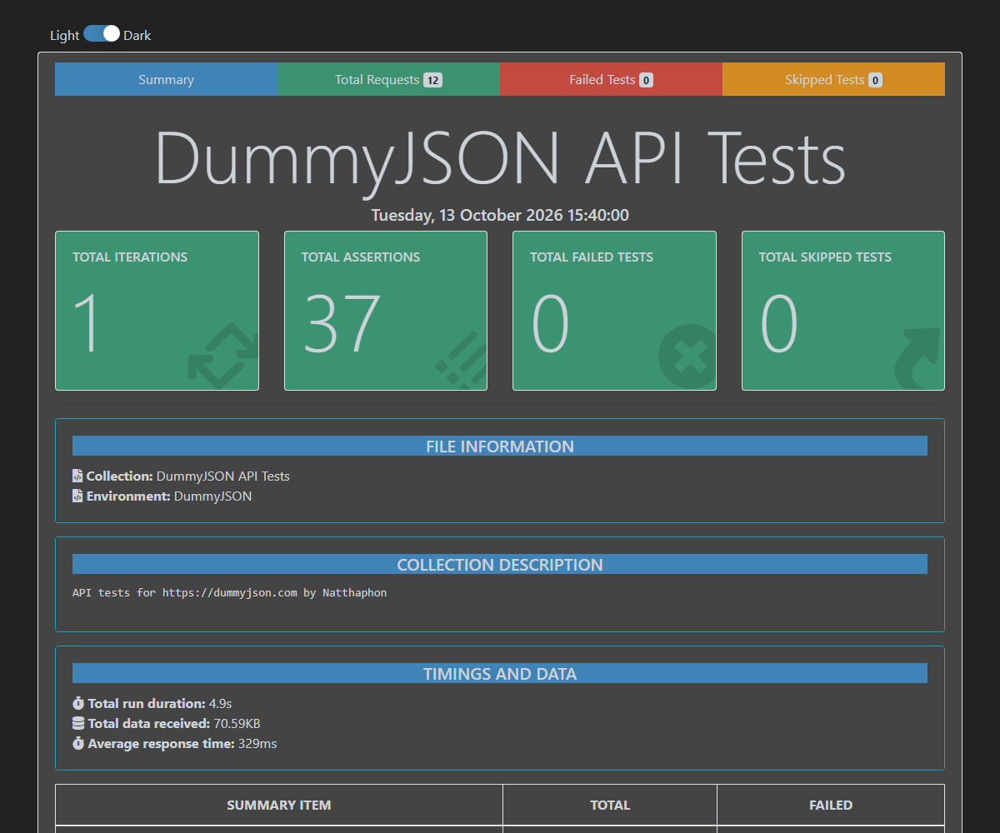

# API Testing with Postman + Newman


Hi, I'm Natthaphon. This is a Postman collection that tests the [DummyJSON API](https://dummyjson.com/docs), a free fake REST API with login, products and CRUD endpoints. I run it with Newman so the same tests work from the command line and in GitHub Actions.

## Test cases

**01 Auth**

| TC | Request | Checks |
|---|---|---|
| TC_01 | `GET /auth/me` without token | 401, "Access Token is required" |
| TC_02 | `POST /auth/login` wrong password | 400, "Invalid credentials" |
| TC_03 | `POST /auth/login` valid account | 200, token returned, saves `accessToken` |
| TC_04 | `GET /auth/me` with token | 200, returns the logged in user |

**02 Products**

| TC | Request | Checks |
|---|---|---|
| TC_05 | `GET /products?limit=10` | 10 products returned |
| TC_06 | `GET /products/1` | product id 1, JSON schema |
| TC_07 | `GET /products/search?q=phone` | at least one result |
| TC_08 | `GET /products?sortBy=price&order=asc` | prices sorted low to high |
| TC_09 | `GET /products/0` | 404, not found message |

**03 Product CRUD**

| TC | Request | Checks |
|---|---|---|
| TC_10 | `POST /products/add` | 201, random title from pre-request script |
| TC_11 | `PUT /products/1` | title and price updated |
| TC_12 | `DELETE /products/1` | `isDeleted` is true |

There's also a collection-level test that runs after every request and checks the response time is under 3 seconds.



## What's inside

```
collections/dummyjson.postman_collection.json
environments/dummyjson.postman_environment.json
.github/workflows/newman.yml
```

A few things I used in the collection:

- **Chaining requests**: TC_03 saves the token with `pm.environment.set("accessToken", ...)` and the later requests use it through Bearer auth `{{accessToken}}`.
- **Pre-request script**: TC_10 makes a random product name with `{{$randomProductName}}`, so every run sends different data.
- **Schema check**: TC_06 uses `pm.response.to.have.jsonSchema()` to check field types.
- **Order matters**: the "without token" test runs before login on purpose. DummyJSON also sets the token as a cookie when you log in, so if it ran after login the request would still be authorized.

The username and password in the environment are DummyJSON's public demo account, not real credentials.

## Running it

### In Postman
Import both files from `collections/` and `environments/`, pick the **DummyJSON** environment, then run the collection with the Collection Runner.

### From the command line
Needs Node.js 20+.

```bash
npm install
npm test
```

The HTML report is saved to `reports/report.html`.

## CI

GitHub Actions runs the collection with Newman on every push and uploads the HTML report as an artifact.
